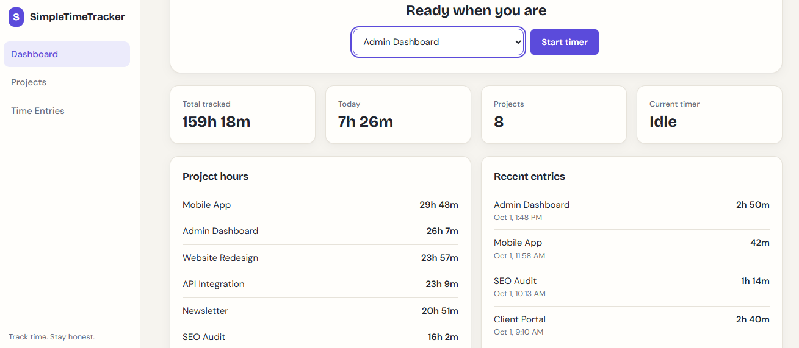
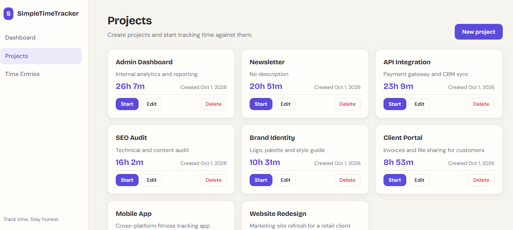
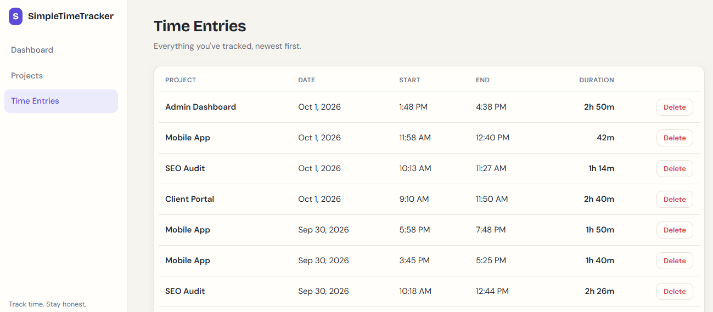

# SimpleTimeTracker

A small, polished time tracker for freelancers. Create projects, start and stop a timer, and see where your hours go.

Repo: https://github.com/asimhashmi47/simple-time-tracker

## Features

- **Dashboard**: total tracked time, today's time, project count, the running timer, recent entries and hours per project
- **Projects**: create, edit and delete, with total hours per project
- **Timer**: one timer at a time, with a live clock. Elapsed time is calculated from the stored start timestamp, so it never drifts. A running timer survives a page refresh because it is stored in the database.
- **Time entries**: view and delete tracked entries
- **UX**: loading, empty and error states, success toasts, delete confirmations, responsive layout

## Screenshots

### Dashboard



### Projects



### Time Entries



## Tech Stack

| Layer    | Technology                                  |
| -------- | ------------------------------------------- |
| Frontend | Angular 20, TypeScript, RxJS, Angular Forms |
| Backend  | Node.js, Express                            |
| Database | SQLite (`sqlite3`)                          |

```
Angular UI  →  Express REST API  →  SQLite
```

## Getting Started

Requires Node.js 22.12 or newer.

```bash
git clone https://github.com/asimhashmi47/simple-time-tracker.git
cd simple-time-tracker
```

**Backend** (http://localhost:3000)

```bash
cd backend
npm install
npm start
```

**Frontend** (http://localhost:4200)

```bash
cd frontend
npm install
npm start
```

**Optional: seed sample data** (8 projects, 100 time entries)

```bash
cd backend
npm run seed
```

Running the seed again adds another batch. Delete `backend/tracker.db` first for a clean 100.

## Configuration

Copy `backend/.env.example` to `backend/.env` if you want to change the defaults.

| Variable      | Default                 | Description          |
| ------------- | ----------------------- | -------------------- |
| `PORT`        | `3000`                  | API port             |
| `CORS_ORIGIN` | `http://localhost:4200` | Allowed frontend URL |

The frontend calls `http://localhost:3000/api` (set in `frontend/src/app/core/api.service.ts`).

## API

| Method | Endpoint                | Description                      |
| ------ | ----------------------- | -------------------------------- |
| GET    | `/api/projects`         | List projects with totals        |
| POST   | `/api/projects`         | Create a project                 |
| PUT    | `/api/projects/:id`     | Update a project                 |
| DELETE | `/api/projects/:id`     | Delete a project and its entries |
| GET    | `/api/timer`            | Current running timer or `null`  |
| POST   | `/api/timer/start`      | Start a timer (`{ projectId }`)  |
| POST   | `/api/timer/stop`       | Stop the timer and save an entry |
| GET    | `/api/time-entries`     | List completed entries           |
| DELETE | `/api/time-entries/:id` | Delete an entry                  |
| GET    | `/api/dashboard`        | Dashboard summary                |

Errors are returned as `{ "message": "..." }` with a suitable status code (400, 404, 409 or 500).

## Project Structure

```
backend/
  src/
    app.js          Express setup
    routes/         projects, timer, timeEntries, dashboard
    db/             SQLite access, schema and seed script
    middleware/     validation helpers and central error handler
frontend/
  src/app/
    core/           API client, timer state, toasts, models
    shared/         timer card, confirm dialog, formatting pipes
    features/       dashboard, projects, time-entries
```

## Security Notes

- Parameterized SQL queries only
- Input validation on every endpoint
- CORS limited to the configured frontend origin
- Generic error messages, with no stack traces or SQL details
- Request body size limit
- No authentication, as this is a single-user MVP

## Known Limitations

- No authentication or multi-user support
- The time entries page shows the latest 500 entries
- The API URL is hardcoded in the frontend

## License

MIT
